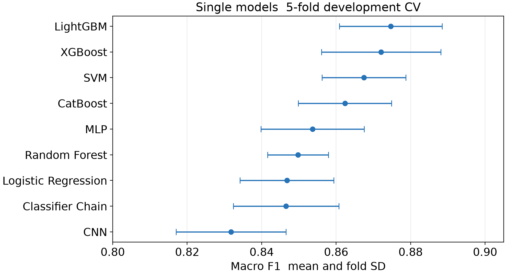
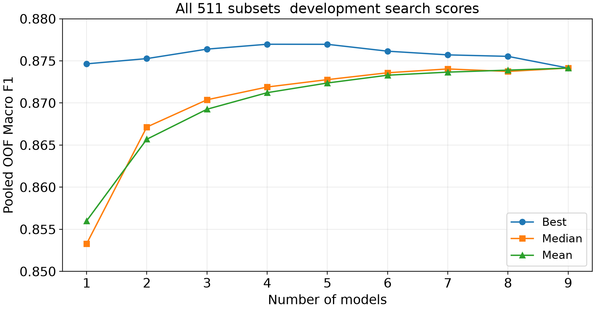

# 2026年11月23日 マルチラベル予測の実験結果と次の手順

## 本日の実施内容と到達点

2026年11月23日 日本時間。ESM-2 650Mの新規特徴量抽出、9モデルの5分割交差検証、OOF予測の保存、511通りの確率平均アンサンブル探索を実施した。単独モデルのCV平均Macro-F1はLightGBMが最上位で、探索ではLightGBM・LR・MLP・XGBoostの4モデル平均が1位となった。

独立テストは本runのcv・ensembleでは使っていない。次は学習側だけで内外CVを行い、候補の選択と評価を分けてSoft VotingとStackingを比較する。本日の探索結果は最終性能の確定値ではない。

実験IDはrun_20261123_150912_555578。保存先はresults_multi_label内。実行機のプロジェクトは/home/user/kurata2026/research825ryuで、以下の続行コマンドもそのLinux環境のプロジェクト直下で実行する。

| 処理 | 本日の状態 |
| --- | --- |
| ESM-2新規推論 | 完了。7,963配列、キャッシュ再利用0件、metadataにfresh_forward |
| 単独9モデルのCV | 完了。学習側7,176配列、共通5分割、閾値0.5 |
| OOF保存 | 完了。全モデル確率テンソルの形状は7176×9×3 |
| ensemble | 完了。単独9と複数モデル502の合計511候補 |
| nested と bias | 未実施。完了記録なし |
| select と final | 未実施。最終構成と本runのテスト成績はまだない |

## データと特徴量の記録

| 項目 | 記録値 |
| --- | --- |
| 統合済み配列数 | 8,002。特殊表記など39件を除外し7,963件を採用 |
| 複数活性 | 747配列を保持 |
| 陽性件数 | 抗酸化995、抗菌3,306、毒性4,411 |
| 分割 | 学習とCV 7,176、独立テスト787。seed 42、iterative stratification |
| ESM-2 | facebook/esm2_t33_650M_UR50D、33層、残基平均、1,280次元 |
| 抽出条件 | BOS・EOS・paddingを平均から除外。CPUで抽出 |
| 抽出完了記録 | 2026年11月23日14時52分23秒 日本時間 |

ラベル順は抗酸化・抗菌・毒性。1は元データに活性記録あり、0は未記録・未知または陰性。0を学習上の陰性として扱うが、生物学的な陰性確認とは区別する。3確率の合計を1にそろえる制約はない。

## 単独9モデルのCV結果

下表は5foldの平均。Macro-F1の±はfold間の標本標準偏差で、信頼区間ではない。完全一致率は3つのラベルをすべて当てた配列の割合。モデル名のLRはLogistic Regression、RFはRandom Forest、ChainはClassifier Chainを表す。

| モデル | Macro F1 平均±SD | Macro AUC | Macro AP | 完全一致率 |
| --- | --- | --- | --- | --- |
| LightGBM | 0.8747 ± 0.0138 | 0.9614 | 0.9466 | 0.7873 |
| XGBoost | 0.8721 ± 0.0160 | 0.9611 | 0.9462 | 0.7809 |
| SVM | 0.8675 ± 0.0113 | 0.9563 | 0.9285 | 0.7819 |
| CatBoost | 0.8624 ± 0.0125 | 0.9578 | 0.9404 | 0.7756 |
| MLP | 0.8537 ± 0.0138 | 0.9609 | 0.9461 | 0.7693 |
| RF | 0.8498 ± 0.0081 | 0.9560 | 0.9319 | 0.7571 |
| LR | 0.8468 ± 0.0126 | 0.9462 | 0.9252 | 0.7419 |
| Chain | 0.8466 ± 0.0142 | 0.9461 | 0.9250 | 0.7370 |
| CNN | 0.8318 ± 0.0148 | 0.9479 | 0.9257 | 0.7464 |

LightGBMとXGBoostが上位で、Macro-F1の差は約0.0026。foldのばらつきもあるため、この差だけで統計的に優れているとは結論しない。CNNのMacro-F1は9モデル中で最も低いが、組み合わせに加えた際の効果は単独順位だけでは決まらない。

## LightGBMの活性別OOF結果

次の表は学習7,176件のOOFをまとめて計算した値。上のfold平均とは計算方法が異なる。Sensitivityは陽性を見つけた割合、Specificityはラベル0を正しく0と判定した割合である。

| 活性 | 陽性数 | F1 | Sensitivity | Specificity | AUC |
| --- | --- | --- | --- | --- | --- |
| 抗酸化 | 895 | 0.8821 | 0.8905 | 0.9817 | 0.9904 |
| 抗菌 | 2975 | 0.8839 | 0.8941 | 0.9086 | 0.9599 |
| 毒性 | 3970 | 0.8579 | 0.8519 | 0.8341 | 0.9331 |

この単独モデルでは毒性のF1とAUCが他の2活性より低い。原因はまだ確定しておらず、ラベルの未記録、活性の共起、配列長や取得元の違いを今後の分析で確認する。

## 保存された評価と学習記録

各モデルにfold別モデル、metrics.json、OOFの正解・予測・確率、活性別指標を保存した。ROC・PR曲線、活性別混同行列、CNN・MLPの学習曲線も出力した。その他の指標にはPrecision、Micro F1、MCC、Hamming loss、Binary Log Loss、Brierが含まれる。

本実行の環境記録はPython 3.10.12、NumPy 1.24.3、scikit-learn 1.2.2、PyTorch 1.12.1+cu113、Transformers 4.46.0、LightGBM 4.6.0、CatBoost 1.2.10、XGBoost 3.0.5。GPU対応版のPyTorchという表記だけでGPU使用とは判断しない。抽出metadataとCNN fold 1はCPUと記録されている。

## 511候補の確率平均探索

保存済みOOF確率を、候補に含むモデル間で活性ごとに等しく平均した。0.5以上を1として判定し、全OOFのMacro-F1で順位を付けた。同点時はMacro AP、少ないモデル数、候補名の順とする。AUCも計算するが、現在の主順位はAUC順ではない。再学習と独立テストの評価は行っていない。

| 順位 | 組み合わせ | Macro F1 | Macro AUC |
| --- | --- | --- | --- |
| 1 | LightGBM＋LR＋MLP＋XGBoost | 0.8770 | 0.9641 |
| 2 | RF＋LightGBM＋LR＋MLP＋XGBoost | 0.8770 | 0.9638 |
| 3 | LightGBM＋MLP＋CatBoost＋XGBoost＋SVM | 0.8768 | 0.9634 |
| 4 | RF＋LightGBM＋MLP＋Chain＋XGBoost | 0.8767 | 0.9638 |
| 5 | LightGBM＋LR＋MLP＋XGBoost＋SVM | 0.8766 | 0.9638 |
| 6 | LightGBM＋MLP＋SVM | 0.8764 | 0.9634 |
| 7 | LightGBM＋MLP＋Chain＋XGBoost＋SVM | 0.8764 | 0.9638 |
| 8 | LightGBM＋LR＋MLP＋CatBoost＋XGBoost | 0.8764 | 0.9641 |
| 9 | LightGBM＋MLP＋Chain＋XGBoost | 0.8763 | 0.9641 |
| 10 | LightGBM＋MLP＋XGBoost＋SVM | 0.8763 | 0.9636 |

## 同じOOFでの比較

| 比較対象 | Macro F1 | Macro AUC | Macro AP |
| --- | --- | --- | --- |
| 最良4モデル平均 | 0.8770 | 0.9641 | 0.9501 |
| 単独LightGBM | 0.8746 | 0.9612 | 0.9457 |
| 全9モデル平均 | 0.8741 | 0.9634 | 0.9473 |

最良平均と単独LightGBMのMacro-F1差は0.002327、約0.23パーセントポイント。1位と2位の差は0.00000728と小さい。いずれも探索に用いた同じOOF上の差であり、新しいデータへの改善が確定したとは言わない。

AUCを最大にする組み合わせはLightGBM＋LR＋MLP＋CatBoost＋XGBoostで0.964134。APを最大にする組み合わせはLightGBM＋MLP＋XGBoostで0.950101。指標によって最上位が変わるため、主指標を事前固定し、補助指標も併記する。

ここでの単独LightGBMのF1は0.874644で、前ページのCV平均0.874688とはわずかに異なる。これは全OOFをまとめる計算とfold平均の違いであり、異なる計算方法を混ぜてensembleの改善量を出していない。

## 本日の結果を図で確認する





モデル数1から9の候補数は順に9、36、84、126、126、84、36、9、1。最高値は4モデル時に得られた。モデル数を増やすと候補全体の中央値や平均は高くなる傾向があるが、全9モデル平均が最良という結果ではない。

元の出力にはoof_roc.png、oof_pr.png、各モデルのoof_confusion_matrices.png、CNN・MLPのloss_curves.png、ensemble/ensemble_search.pngもある。細かな数値は元CSV・JSONと併せて確認する。

## 次に実行する内外CV

次はnested。目的は、組み合わせ選択に使っていない外側のデータで、確率平均とStackingの違いを確かめること。独立テスト787件はこの段階の選択・学習・評価に入れない。

| 手順 | 具体的な処理 |
| --- | --- |
| 1 外側5分割 | 学習7,176件のうち1foldを評価用として確保し、残りを外側学習とする |
| 2 内側5分割 | 外側学習の中だけで9モデルを再学習し、内側OOFを作る |
| 3 候補を選択 | 内側OOFで511候補を比較し、その外側fold用のTOP10を選ぶ |
| 4 メタLRを学習 | 候補ごとに抗酸化・抗菌・毒性のLRを1本ずつ学習する |
| 5 外側を予測 | ベースモデルを外側学習全体で学習し直し、確保した外側foldを予測する |
| 6 ペアで評価 | 同じ候補と同じ外側foldについて、確率平均とStackingの差を計算する |
| 7 5回を集計 | 外側の評価部分を変えて繰り返し、平均・SD・fold別の差を保存する |

例えば外側fold 1は学習5,752件、評価1,424件。この5,752件の中で内側CVを行う。内側OOFで学習したLRにとって、外側評価1,424件は候補選択にもメタ学習にも使っていないデータとなる。

4モデル候補なら、抗酸化用LRは4モデルの抗酸化確率4つを入力にする。抗菌と毒性も同様で、計3本のLRとなる。現在は他活性の確率を混ぜない。C=1、class_weightなし、判定閾値0.5を実験設定から復元する。

外側foldごとに内側でTOP10を選ぶため、TOP01の具体的な組み合わせは毎回変わり得る。今日の全体OOFのTOP10と、各外側foldのTOP10を区別して保存する。ベスト単独と全9モデル平均も比較対象に残す。

nestedは再学習を伴う。既定では9モデル×外側5回×（内側5回＋外側での再学習1回）で270回のベースモデル学習呼び出しがある。活性別二値分類器やCNN・MLPの内部検証を含めた実際の学習処理はさらに多い。完了済みfitはデータと設定が一致すれば再利用される。

## nestedの終了後に確認するもの

stage_nested.jsonがcompleteであること、nested/summary.csvの成績とSD、fold_comparisons.csvの具体的な構成、paired_differences.csvのStacking−Votingの差、paired_comparison.pngを確認する。複数foldで一貫して改善しているかを見て、1回の大きな改善だけで判断しない。

## その後のbiasと最終構成の固定

biasでは長さだけを入力にしたLRを同じ開発用CVで学習する。ESM特徴量を使わなくても高い成績になる場合、配列長の分布差が予測に関係している可能性がある。長さ分布と、共通長範囲に限定した既存OOFの成績、モデル間の誤り一致率・相関も保存する。共通範囲の処理は範囲内だけでモデルを再学習する実験ではない。

selectは外側CVの平均Macro-F1、平均Macro AP、平均モデル数、roleとmethodの順に最終手順を選ぶ。学習90%全体のランキングで具体的な構成を固定し、final_recipe.jsonに構成・閾値・メタLR設定・参照ファイルのハッシュを保存する。

## 最後のfinalで行うこと

必要なStackingのLRを学習90%全体のOOFで学習し、ベースモデルを90%全体で学習し直す。その後、独立テスト787件を予測し、選択構成・ベスト単独・全9モデル平均を一括評価する。AUC、F1、Sensitivity、Specificity等とROC・PR・混同行列を保存する。テスト結果で構成や閾値を選び直さない。

今回のholdout787配列は、Git履歴に残る11月17日の旧実験のテスト787配列と、配列集合がすべて一致した。本runでは未使用でも、研究全体では過去に評価済みである。今後のfinalは既存holdoutでの確認として記録し、完全に新しい外部検証の結果とは呼ばない。厳密な新規確認には別の未使用データが必要となる。

## 実行コマンド

```bash
RUN_DIR=results_multi_label/run_20261123_150912_555578
python main_multi_label.py --stage nested --run-dir "$RUN_DIR"
python main_multi_label.py --stage bias --run-dir "$RUN_DIR"
python main_multi_label.py --stage select --run-dir "$RUN_DIR"
# 上記の結果と最終構成を確認してから実行
python main_multi_label.py --stage final --run-dir "$RUN_DIR"
```

続行時は--run-dirと--stageだけを指定し、保存された設定を使う。実行機のパスが保存されているため、学習したLinux環境で行う。途中でコードや特徴量を変えるとハッシュ照合で停止する。finalはアクセスを記録し、同じrunの再実行を停止する。

## 本日の保存物と残る課題

実行記録はrun_config.json、stage_cv.json、stage_ensemble.json。9モデルのCV・OOF、511候補のranking.csv・by_model_count.csv・selection.json、Excel集計と図を保存済み。nested、bias、select、finalはまだ実行していない。本ログ作成では結果の読み取りと図の再作成だけを行い、新たなモデル学習は行っていない。

類似配列クラスタ分割、未記録ラベルと実測陰性の区別、確率校正、溶血性モデルは引き続き課題。確認した元ファイルのハッシュ、環境、結果の詳細、旧holdoutとの照合根拠は2026-11-23_result_evidence.jsonに記録した。
